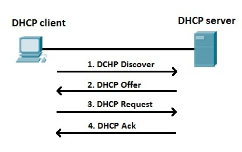
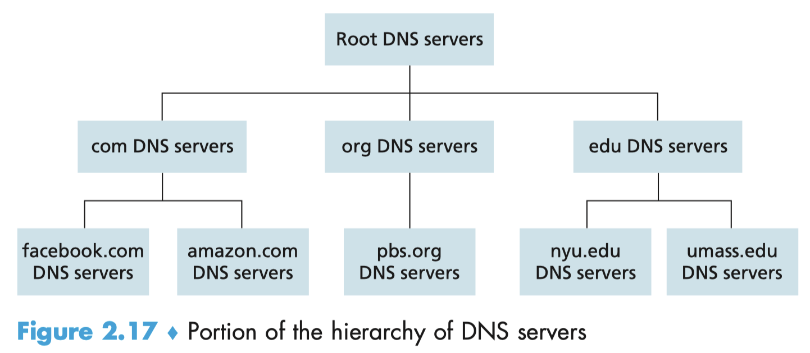
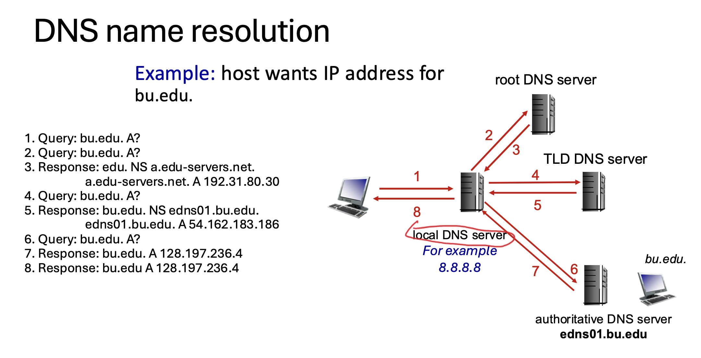
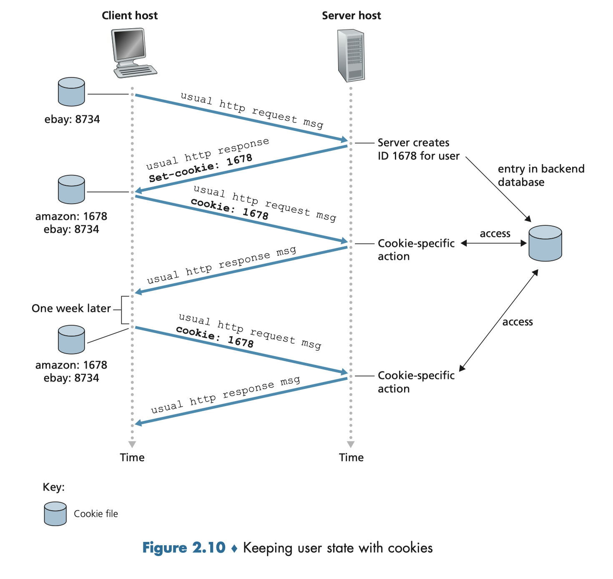

## DHCP
DHCP (Dynamic Host Configuration Protocol) is a network management protocol that automatically assigns an IP address and other network settings to devices as they connect to a network

**Host get 4 key information from DHCP protocol**
1. IP address
2. Subnet mask (e.g. /24)
3. Default gateway IP
4. DNS server IP (address resolution / translation IP)
    - : DNS serves the function of address resolution / translation.

**To get a sense of what is subnet mask**\
An IPv4 address is a 32-bit address used to identify a device on a network. Since **the Internet is a network of networks**, an IPv4 address must also indicate which network or subnet the device belongs to. A subnet mask divides an IPv4 address **into two parts**: the network part and the host part. The network part identifies the subnet, while the host part identifies the specific device within that subnet.

For example, if the IPv4 address is $192.168.1.25$ and the subnet mask is $255.255.255.0$, or $/24$, the first 24 bits ($192.168.1$) are the network part. Therefore, the device belongs to the subnet $192.168.1.0/24$. The remaining 8 bits are the host part, and 25 identifies the specific device. Thus, $192.168.1.10$ and $192.168.1.25$ are in the same subnet, while $192.168.2.10$ is in a different network and normally requires a router to communicate with them.

**Default Gateway**
A default gateway is the router that a host sends packets to when the destination is outside its local subnet. (If a destination is not in local subnet, what first router I should send the packet to)

## what is address resolution and translation
Address resolution / translation means converting a name that humans use into an IP address that computers use.

For example:

www.google.com → 142.250.xxx.xxx

## DNS
What is DNS?
- Domain Name Service serves the function of address resolution and translation.
- It is implemented as a distributed database in a hierachy of DNS servers
- An application-layer protocol that allows hosts to query the distributed database

Other minor services provided
- Host Aliasing
- Mail server aliasing
- Load Distribution

### A distributed, Hierarchical Database

- Root DSN servers: 400 scattered all around the world. It provide the IP addresses of the TLD servers.
- Top-level domain servers: Top-level domains include com, gor, net, edu and gov and country top-level domain such as uk, fr.... It provide the IP addresses for authoritative DNS servers.
- Authoritative DNS servers: orgnization(company or school...) have DSN records mapping hosts to IP address. They can hold records in their own implemented Authoritative DNS server or service provider.
- Local DNS server

## DNS Records and Message
A resource record is a four-tuple that contains (Name, Value, Type, TLL). TLL is the time to live of the resource record, determining when a resource should be removed from a cache.

- Type=A, Name is hostname and Value is the IP address. Eg. (relay1.bar.foo.com, 145.37.93.126, A)
- Type=NS, Name is a domain, Value is host name of an authoritative DNS server. Eg (foo.com, dns.foo.com, NS)
- Type=CNAM, Value is a canonical host name for the alias hostname. Eg. (foo.com, relay1.bar.foo.com, CNAME)

An example, suppose an edu TLD server is not authoritative for the host gaia.cs.umass.edu. Then this server will contain a record for a domain that includes the host gaia.cs.umass .edu, for example, (umass.edu, dns.umass.edu, NS). The edu TLD server would also contain a Type A record, which maps the DNS server dns.umass.edu to an IP address, for example, (dns.umass.edu, 128.119.40.111, A).

## DNS Cache
When a DNS server receives a DNS reply, it can cache the mapping in its local memory. If a hostname/IP address pair is cached in a DNS server and another query arrives to the DNS server for the same hostname, the DNS server can provide the desired IP address, even if it is not authoritative for the hostname.

### Example of a DNS path

## HTTP
- RTT (Round-trip time), TCP 3-way handshake?
- HTTP request message
- HTTP response message
- HTTP header
- HTTP Body
- HTTP status code
- Both HTTP1.1 and HTTP/2 is over TCP
- Variants
    * Non-persistent HTTP
    * Persistent HTTP (Multiple HTTP go over one TCP)
    * Persistent with pipeline  (without waiting for the responses to come back first) 
        + may encounter Head-of-Line Blocking
    * HTTP2
        + Within the same TCP connection, multiple HTTP requests and responses can be transmitted concurrently in an interleaved manner. HTTP/2 breaks each request/response into many small frames and assigns different requests to different streams.
- Stateless
    * An HTTP server maintains no information about the clients

### Cookies
1. a cookie header line in the HTTP response message; 
2. a cookie header line in the HTTP request message; 
3. a cookie file kept on the user’s end system and managed by the user’s browser
4. a back-end database at the Web site.

## Proxy
- Forward Proxy
    * Sit in client side, help client to connect outside internet
        + Privacy protection: hide clients ip
        + Security: Block malicious websites
        + Caching/Performance: When 100 students access same website, proxy cache contents to reduce traffic
- Reverse Proxy
    * Sit in server side, help server get requests
        + Load Balancing