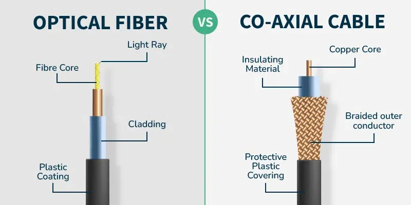
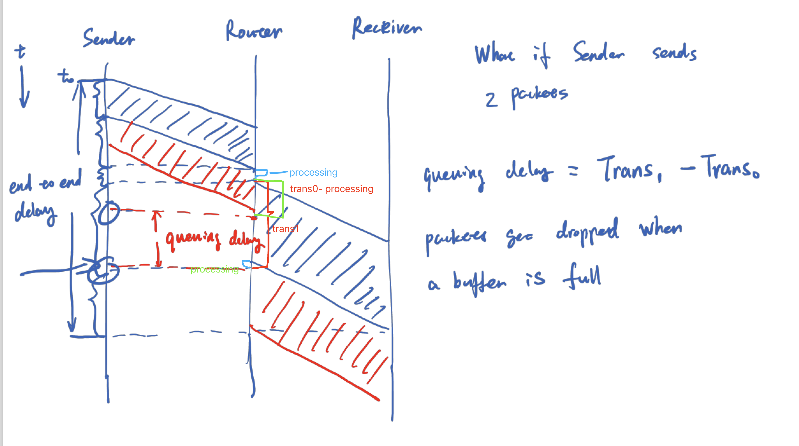
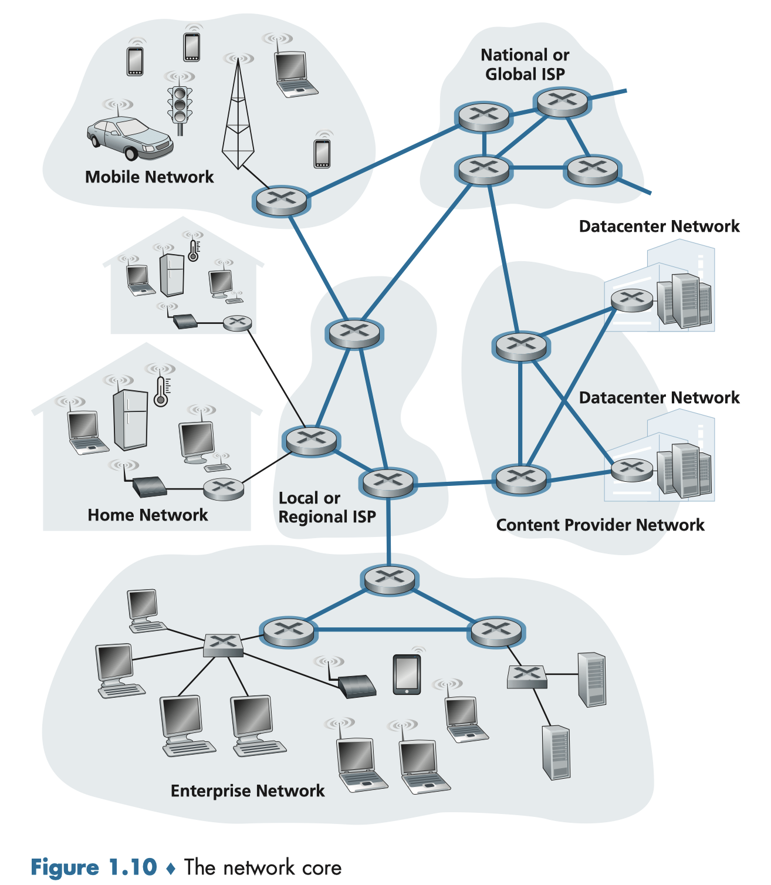
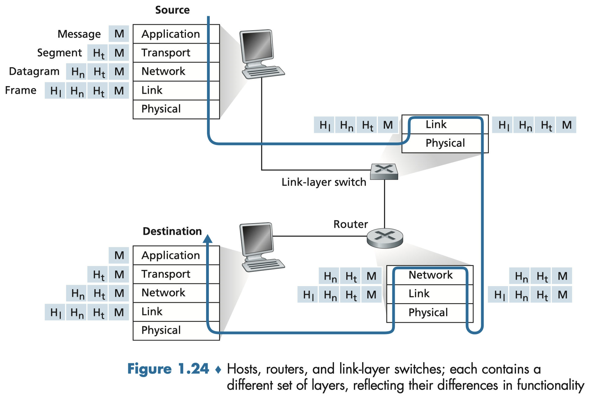

## Basic Def
- **hosts or end system**
    * In Internet jargon, all of these devices are called hosts or end systems. **Internet is a network of networks**
- **what is packet**
    * In networking, a packet is a small segment of a larger message. Data sent over computer networks, such as the Internet, is divided into packets. These packets are then recombined by the computer or device that receives them.
- Packet switches
    * **Routers** (Connects different networks and mainly uses IP addresses to forward packets.)
    * **Link-layer switches** (Connects devices within the same local area network (LAN) and mainly uses MAC addresses to forward frames.)

## Packet Switching
### Store and Forward transmission
**Def:** The packet switch must receive the entire packet before it can begin to transmit the first bit of the packet onto the outbound link. (In short, buffer the data until all arrive). Outbound link can be a variety of format, such as Ethernet cable, Fiber optic cable, Wireless link...

**Different physical media**
Common media including coaxial cable, copper wire, optical fiber, and radio spectrum.

**Where queuing delay comes from:** Each packet switch has multiple links attached to it. For each attached link, the packet switch has an **output buffer** (also called an output queue), which stores packets that the router is about to send into that link. The **output buffers** play a key role in packet switching. If an arriving packet needs to be transmitted onto a link but finds the link busy with the transmission of another packet, the arriving packet must wait in the **output buffer**. 

**Packet loss:** Since the amount of **buffer space** is finite, an arriving packet may find that the buffer is completely full with other packets waiting for transmission. In this case, packet loss will occur—either the arriving packet or one of the already-queued packets will be dropped.

## Delay
- Transmission Delay
    * Amount of time required to push (that is, transmit) all of the packet’s bits into the link.
    * Transmission Rate: bits/sec, Mbps(i.e. mega bits per second)
    * Delay: L/R (L Packet length, R bits/sec)
- Processing Delay
    * The time required to examine the packet’s header and determine where to direct the packet is part of the processing delay.
- Queuing Delay
    * Packet experiences a queuing delay as it waits to be transmitted onto the link.
- Propagation Delay
    * The propagation speed depends on the physical medium of the link

### Traffic Intensity
Traffic intensity is a measure of how heavily a network link is being used. Assume all packets consists of $L$ bits. Average rate at which packets arrive at the queue ($\alpha$ is in units of packets/sec). $R$ is the transmission rate which is in units of bits/sec. $$L\alpha/R$$ is traffic intensity
- $L\alpha/R > 1$, the average rate at which bits arrive at the queue exceeds the rate at which the bits can be transmitted from the queue. The queue tends to increase and approach to infinity.

### Queuing delay example

## Internet is a network of networks

- Network core: the mesh of packet switches and links that interconnects the Internet’s end systems
- Network edge:

## Throughput
If the file consists of $F$ bits and the transfer takes $T$ seconds for Host B to receive all $F$ bits, then the average throughput of the file transfer is $\frac{F}{T}$ bits/sec.

## Goodput
The rate of useful data that arrives at the destination, excluding protocol overhead and retransmitted data.

## 5 layers and concept of encapsulation
This picture shows the physical path that data takes down a sending end system’s protocol stack, up and down the protocol stacks of an intervening link-layer switch and router, and then up the protocol stack at the receiving end system.

**encapsulation**

At the sending host, an application-layer message is passed to the transport layer. In the simplest case, the transport layer takes the message and appends additional information (transport-layer header information, $\text{H}_\text{t}$) that will be used by the receiver-side transport layer.\
The application-layer message and the transport-layer header information together constitute the transport-layer segment. The transport-layer segment thus encapsulates the application-layer message. The added information might include information allowing the receiver-side transport layer to deliver the message up to the appropriate application, and error-detection bits that allow the receiver to determine whether bits in the message have been changed in route.

We see that at each layer, a packet has two types of fields: header fields and a payload field