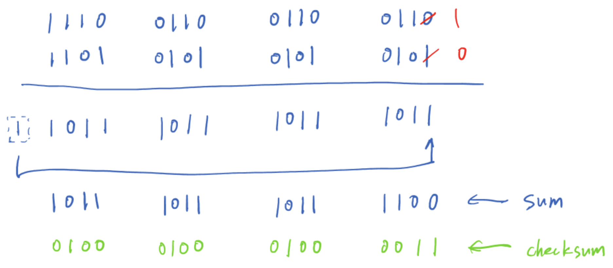
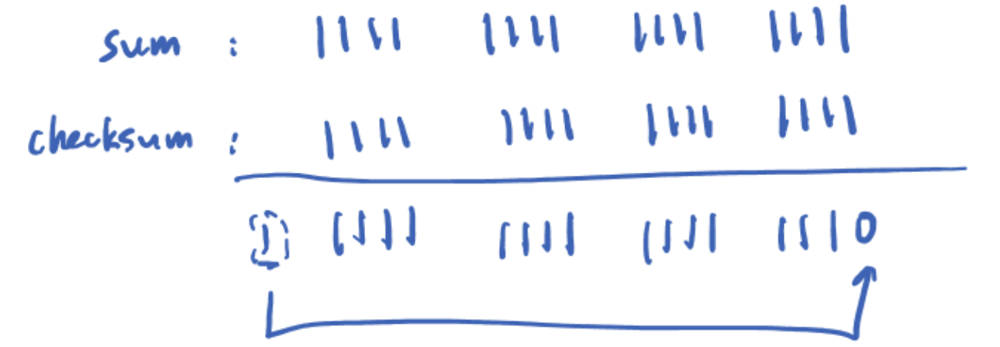
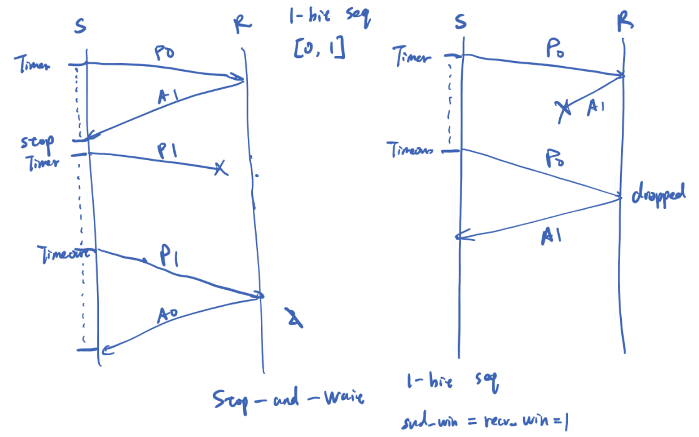
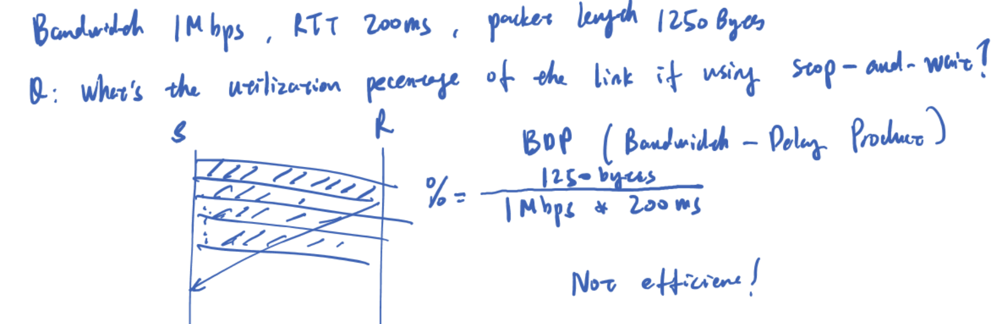
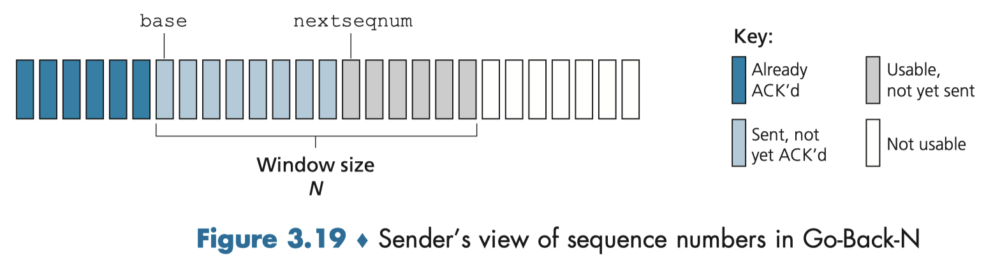
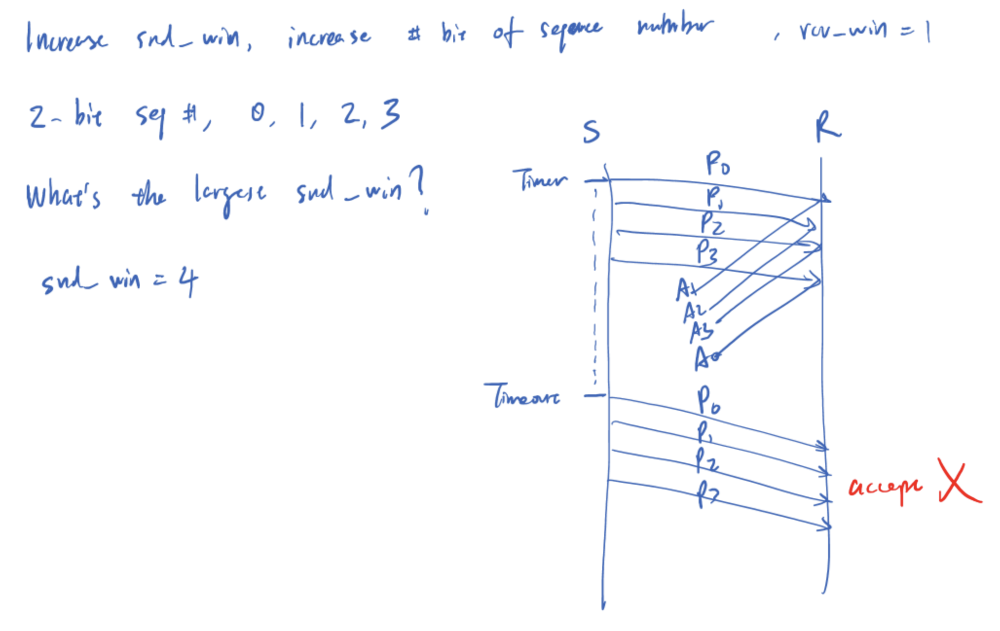
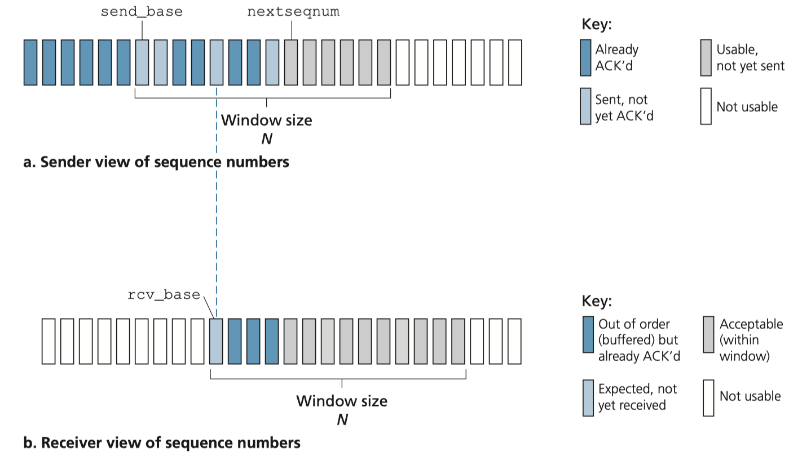
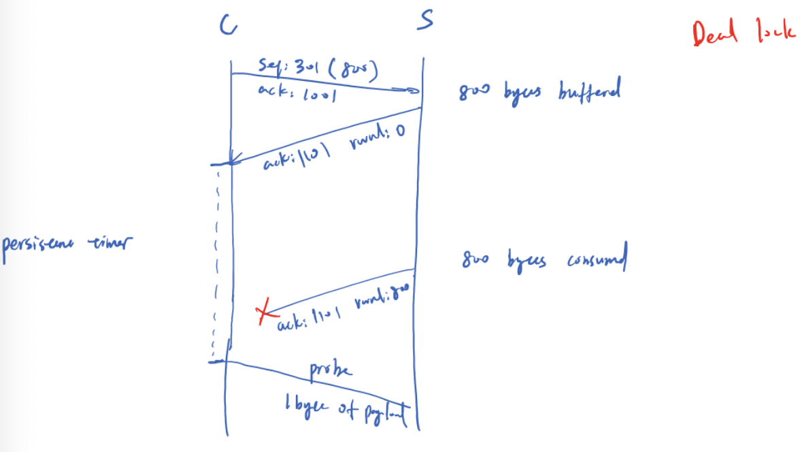
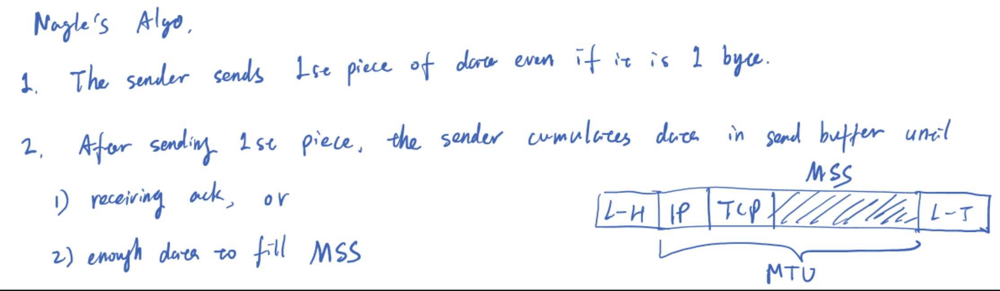

# Transport Layer
**Sidenote:** *If you have not yet took OS course, you can think of process as a program. Many different process is running on your host.*

A transport-layer protocol provides logical communication between **processes** running on **different** hosts, a network-layer protocol provides logical communication between hosts. K&R Book give an analogy on Households (If you are intersted, plz refer to page 184 Chapter 3, 8th Edition). 

In short, 
- transport layer: process-to-process
- network layer: host-to-host

- transport-layer packet: Segment
- network-layer packet: Datagram

Every host has an IP-address. The IP service model is a best-effort delivery service, which is said to be an unreliable service. If we use TCP as our transport layer, reliability can be guaranteed.

**What means reliability in network** \
4 aspects, corresponding machanism?
- no corruption
    * Corruption means that the data is changed or damaged during transmission. Corruption is usually detected by checksum. 
        + UDP’s checksum can detect that the received data may be corrupted, but UDP itself usually does not retransmit the corrupted data.
        + TCP has other machinism such as retransmission to guarantee reliable delivery
- no loss
- in order
- no duplicates

## Overview of UDP and TCP
- UDP
    * process-to-process data delivery
    * error checking
- TCP
    * Reliable data transfer (with tech such as flow control, sequence numbers, acknowledgments, and timers)

## Multiplexing and Demultiplexing
**What is Multiplexing and Demultiplexing:** Extend host-to-host delivery to process-to-process delivery.
- demultipling happened in receiver side

An application process can have one or more **sockets**, doors through which data passes from the network to the process and through which data passes from the process to the network. Each socket has an identifier (port number).

It is important to note that a **UDP socket** is fully identified by a **two-tuple** consisting of a destination IP address and a destination port number. As a consequence, if two UDP segments have different source IP addresses and/or source port numbers, but have the same destination IP address and destination port number, then the two segments will be directed to the same destination process via the same destination socket.

However, in **TCP** two arriving TCP segments with different source IP addresses or source port numbers will be directed to two different sockets. Besides the welcoming socket, the newly created connection socket is **identified** by these **four values** (IP address and port number for source and destination host)

## UDP
- connectionless
- segment structure
    * 

## Checksum
The checksum is used to determine whether bits within the UDP segment have been altered.

- **Sender**: Sender has to do some operations to figure out what the checksum field is. **Operation:** Perform 1s complement (changing every 0 to 1, changing every 1 to 0) of the sum of all the **16-bit** words in the segment, with any overflow encountered during the sum being wrapped around. That's equals to checksum field
    * An example copied from 2026 fall lecture slides
- **Receiver**: add all the 16-bit words in the segment, then add it with receiving checksum field. 
    - If all 1 (1111111...), consider no error, 
    - else error.

**2 bit error can be undetected**

For IPv4, checksum is optional. If we want to skip it, we put all 0s in the checksum field. 

**But will this skipping case be confused with the not-skipping case that we concidentally want to put all 0 in checksum field （i.e. sum 111... -> checksum 000...）:**
No confusion for the case . In this case we choose to put all 1 in checksum field. Then, at receiver side calculation would be
- 

# Different variant of reliable data transfer protocol
To make your life easier, I would recommend separating the concepts here from the TCP section later. Personally, I think this part is intended to introduce how to build a **reliable** data transfer protocol, and to show which protocols can achieve higher efficiency while maintaining reliability.

Why I said separate the concept here from the TCP section: TCP is a hybrid protocol that primarily uses a variant of Go-Back-N (GBN) ARQ with cumulative acknowledgments, but it acts like a Selective Repeat protocol when the SACK (Selective Acknowledgment) extension is enabled
## stop-and-wait
**Most Inefficient**
- sequence number is 0 and 1, so it is also called alternating-bit protocol
- retransmission timer
- 
- bad utilization
    * Bandwidth-Delay Product: total amount of data that can be in flight between sender and a receiver. $Bandwidth \times RTT$
    * $\text{Utilization} = \frac{\text{Effective Throughput}}{\text{Theoretical Maximum Throughput}} = \frac{\frac{\text{TCP window size}}{RTT}}{\frac{BDP}{RTT}} = \frac{\text{TCP window size}}{BDP}$
    * Eg. 
    * The TCP Window Size is the amount of unacknowledged data a receiving device can accept at once.

### What is sending window
A send window in TCP is the range of sequence numbers that a sender is allowed to transmit before it must receive an acknowledgment (ACK) from the receiver.

Picture below is a sending window of GBN.


### Can we just simply increase the sending window to achieve the better performance.

This case, receiver thinks retrasmitted P0-P3 as new coming data. This violate the **no duplicate** property of reliable data transfer. 


## GBN
### what is sending window in GBN

### what is outstanding window
A packet that has been sent by the sender but has not yet been acknowledged by the receiver (From sender's view). It represents data **'in flight'**.
### Rule
- **Discard** out-of-order packet (do not buffer in receiver), which means receive_window = 1
- if timeout in sender, then retransmit all previously sent and not yet ack packet
- timer set only for the oldest transmitted and not yet acknowledged packet.
- $send\_win + rcv\_win \le 2^m$, where m is sequence number and $rcv\_win = 1$
- **NOTE:** In the lecture slides, the ACK number sent by the GBN receiver to the sender represents the sequence number of the next packet that the receiver expects. This is different from textbook's(K&R Book) graph annotation. Plz follow lecture slides.


## Selective-Repeat
Avoid unnecessary transmission
### What sending window and receiving window looks like

### Rule
- $\text{snd\_win} = \text{rcv\_win}$ and $\text{snd\_win}+\text{rcv\_win}\le 2^m$, m is how many bit to represent seq or ack number. If m=2, then we use $2^2=4$ number to represent ack number at the same time.
- Annotation different with GBN
- Sender
    * **Each packet has a timer**, if timeout, retransmit
    * (**It seems we will not test you on send_win annotation, however you have to draw each packet's timer-start and timeout in the exam**)
        + If Ack is received by sender and packet number equals to send_base, window move forward to unacked packet with the smallest number. If not equals to send_base but in sending window, we mark that packet ack'd.

- Receiver
    * (It seems we **will test** you on rec_wind annotation)
        + When packet with sequence number in window is received, ack it. If it equals to rcv_base, window move forward. Otherwise buffer the packet.
- Demo one


## TCP
- Connection oriented
    + establish a connection through a three-way handshake
- reliable stream data transfer
    + sequence number help the receiver detect the order of the data and whether any data is missing.
    + An ACK indicates the next byte the receiver expects.
- Flow control 
    + prevents the sender from sending data faster than the receiver can process it.
    + The receiver tells the sender how much more data it can accept, and the sender limits how much it sends accordingly.
- Congestion control 
    + helps prevent too much data from overwhelming the network.

## TCP termination
- FIN flag consumes one sequence number
- half-close: A half-close in TCP termination happens when one side finishes sending data and sends a FIN packet, while the other side acknowledges it (ACK) and continues sending data
- transitino from FIN-WAIT-1 to FIN-WAIT-2 happens when receiving the ack for FIN packet
- Time-wait = 2 x MSL (Maximum Segment Lifetime)
    1. LAST-ACK can be lost, then FIN from receiver will retransmitted
    2. connection reincarnation, do not pollute next connection

## TCP connection reset

TCP Connection Reset (RST) is used to immediately terminate a TCP connection without going through the normal four-way handshake. Unlike FIN, RST closes the connection abruptly. It typically occurs when a host receives a segment for a nonexistent connection, a client tries to connect to a closed port, or an application encounters an error and needs to abort the connection.

## Flow control
- The send window is determined by the ACK number and rwnd field in the packets received from the receiver side.
- rcv window is increased when application consumes data, and decrased when in-order data gets received.

## Persistent timer
It handles a zero-window situation, avoid deadlock. If we don't have persistent timer, in the case below, the sender will think the receiver has no space to consume data forever.


## Silly window syndrome
**What is this:** A TCP networking inefficiency where data is transmitted in tiny segments with huge header-to-payload ratios, drastically reducing network throughput. This usually caused by two case
- The receiver processes data slowly, freeing up only a small amount of space in its receive buffer at a time and advertising a very small receive window, which causes the sender to send only small amounts of data.
- The sender application generates only small amounts of data at a time. e.g., an application may send a TCP segment every time the user types a single character.


## Nagle's algo
**Nagle's algo can solve silly window syndrome caused by slow sender**

**Use one sentence to describe the algo**: At most one unacknowledged small TCP segment per connection.


Detail on that rectangle graph
- L-H: Link-layer header
- IP: IP header
- TCP: TCP header
- shaded area: TCP Payload or we can say it as Application data (the actual information (or message) that the application wants to send.)
- MSS: the largest amount of data (payload) a device can accept in a single TCP segment, excluding the TCP and IP headers
- MTU = IP header + TCP header + MSS
- L-T: Link-layer Trailer

## TCP delayed acknowledgment method
**This method solve silly window syndrome caused by slow receiver**
Rules:
1. Piggybacking: Instead of sending a separate, standalone ACK frame, attach Ack for previously received data onto an outgoing data packet 
2. Delayed Ack: Delay sending ack up to preset delay (< 500ms) when receiving one in-order segment
3. Immediate Ack on two in-order segments
4. Immediate ack on out-of-order segments
5. Immediate Ack on previously missing segments
6. Immediate Ack on duplicates

**Fast retransmission**: is a mechanism that detects a lost packet and retransmits it immediately upon receiving three duplicate ACKs (making 4 identical ACK numbers in total), without waiting for the retransmission timer (RTO) to expire.

# Congestion control
## Retransmission Timer in TCP (when timer should start, restart or stop)
**TCP only maintain one Retransmission Timer at a time**\
**You can think of segment in front of send window as the oldest unacknowledged segment. Also, segment is just packet here.**
1. (Timer starts when sender sends segment in front of send window.) -> The retransmission timer starts when the sender sends data and there is no retransmission timer already running. (This is trivial)
2. When new data gets acknowledged, timer stops or restarts
    - If all sent data has been acknowledged, stop the retransmission timer.
    - If there is still outstanding data (data that has been sent but not yet acknowledged), restart the timer for the oldest unacknowledged data.
3. When timer goes off, segment in front of send window gets retransmitted.

## How to set the retransmission time (RTO calculation)

### Motivation

- if it is too small
    * Ack is still on the way
    * unnecessary retransmission
- if it is too long
    * packet indeed lost, receiver wait too long getting the retransmitted packet -> high latency

Thus, we use measured RTT to dynamically set up the RTO.

### Rule
1. There can be only one RTT measurement in progress at any given time
2. TCP does not measure RTT for retransmitted segments


**Terminology**: 
- RTTs: You can think of Smoothed RTT is the same thing as Estimated RTT. 
- RTTm: Measured RTT. 
- RTTd: RTT deviation

```
For the first RTT measurement:
RTTs = RTTm

For the second and subsequent RTT measurements:
RTTs = (1 - α) × old RTTs + α × new RTTm

α = 0.125
```


RTTd measures the difference between the measured RTT (RTTm) and the smoothed RTT (RTTs), reflecting how much the network delay fluctuates.
```
RTTd: RTT Deviation
For the first RTT measurement: 
RTTd = RTTm / 2

For the second and subsequent RTT measurements:
RTTd_new = (1 - β)RTTd_old + β |RTTs_old - RTTm_old|
β = 0.25
```

```
Upon a new RTTm:
RTO = RTTs + 4RTTd
```

**Trying to understand why each formula is designed this way can better help you comprehend this section.**

## Back to send window
The TCP Send Window is the maximum amount of data a sender is allowed to transmit before waiting for an acknowledgment (ACK) from the receiver.
It is a crucial flow-control and congestion-control mechanism that prevents the sender from overwhelming the receiver's buffer or flooding the network

Dynamic Limit: The send window isn't static. Its size is determined by the minimum of two factors: the receiver's available buffer space (the Receive Window) and the network's current capacity (the Congestion Window).

Thus, we have send_wind = min (rcv_wind, cwnd). If we only consider the impact of congestion control, we can assume rcv_wind >> cwnd.

**High level idea of congestion control:** When network communication is going smoothly, TCP gradually increases its sending rate. When congestion is detected, TCP reduces its sending rate.

## TCP Pre-Reno (a name I give)
- Initialization cwnd =1
- AIMD (Additive Increase, Multiplicative Decrease)
    + cwnd increases by 1 MSS per RTT.
    + When congestion is detected, TCP reduces cwnd.
        * On RTO (Retransmission Timeout): cwnd = 1 MSS.
        * On 3 duplicate ACKs: cwnd = cwnd / 2.

As we saw in class, it takes a long time for TCP to fully utilize the available bandwidth.

## TCP Reno
The case TCP increase send window(congestion window): 
- cwnd <= ssthresh
    + slow start (exponential increase): cwnd increase by 1 per ACK (double per RTT)
- cwnd > ssthreash
    + congestion avoidance (addictive incrase): cwnd increase by 1 per RTT

The case TCP decrease send window(congestion window)
- RTO
    * ssthreash = cwnd/2, cwnd=1, go to slow start
- 3 duplicate acks
    * cwnd= cwnd_old /2, go to congestion avoidance


